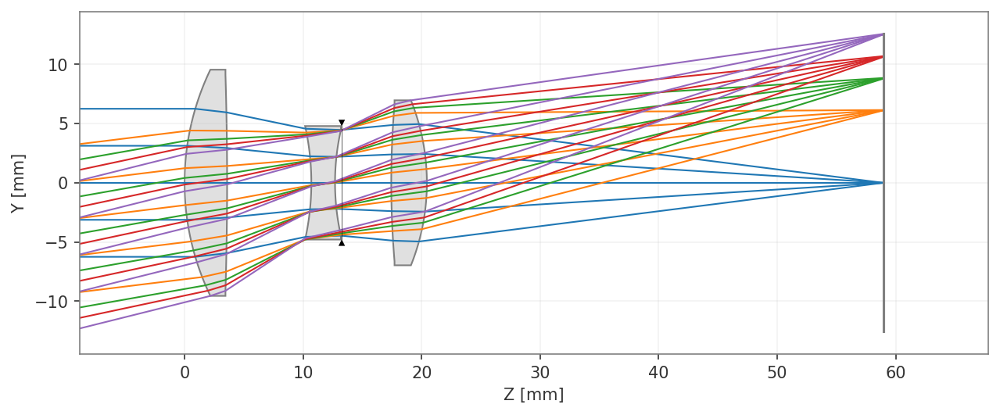
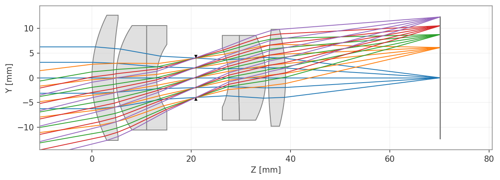
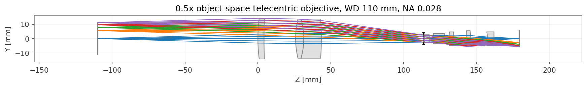
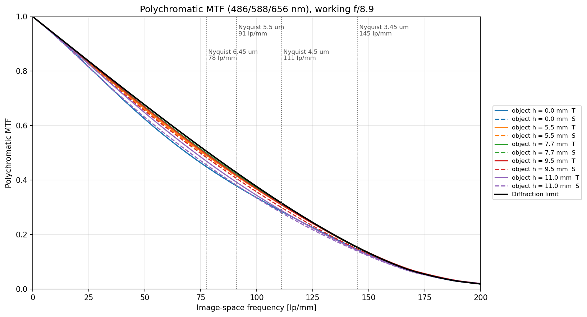

# Optiland Lens Designs

Lens designs made and optimized in Python with [Optiland](https://github.com/HarrisonKramer/optiland), an open-source optical design library.

Each design folder has a notebook (runs on Colab), the lens file (`.json`) and the result plots.

## Designs

| # | Design | Specification | Result |
|---|---|---|---|
| 01 | [Cooke triplet](designs/01_cooke_triplet) | f = 50 mm, f/4, 0–14°, 3 elements | RMS spot 10.3 µm |
| 02 | [Double Gauss](designs/02_double_gauss) | f = 50 mm, f/4, 0–14°, 6 elements | RMS spot 5.5 µm |
| 03 | [0.5× object-telecentric objective](designs/03_telecentric_0.5x) | WD 110 mm, NA 0.028, 2/3" sensor, 8 elements | RMS spot 2.1 µm, distortion 0.018 %, telecentricity 0.001° |

Designs 01 and 02 solve the same challenge: minimize the polychromatic RMS spot (486/588/656 nm) over 5 fields with all-spherical surfaces and catalog glasses.

<p align="center">
  
  
  
</p>

The telecentric objective also includes an MTF check against real machine-vision sensors:

<p align="center">
  
</p>

## How to use

```bash
pip install -r requirements.txt
```

- **Notebooks:** open them in Jupyter or upload them to Google Colab and run all cells.
- **Optiland GUI:** File → Open → select a design's `.json`.

Tested with Optiland 0.6.2.

## Adding a design

Create `designs/NN_name/` with the notebook, the `.json` and the plots, then add a row to the table above.
